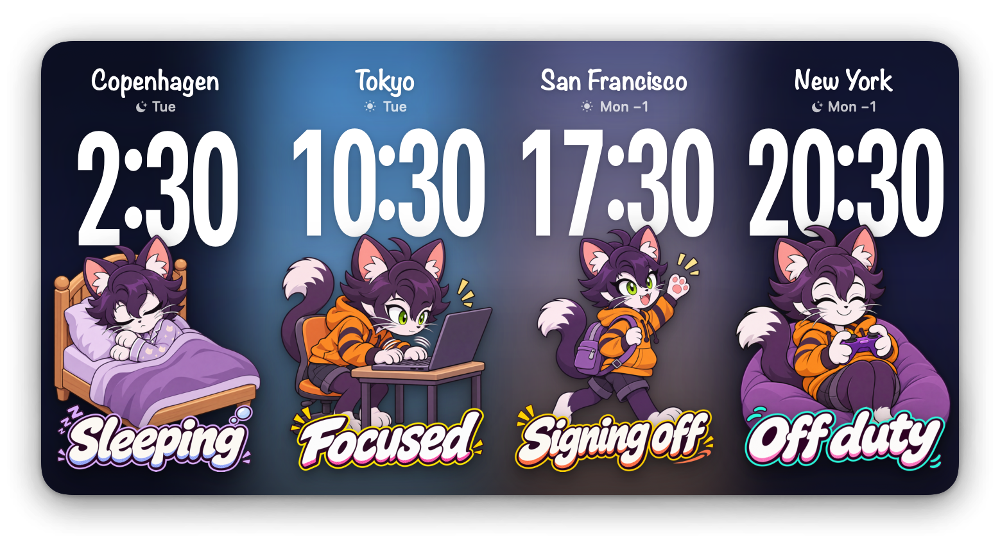

# Unity Office Clock

A macOS widget showing the time in Unity's main offices: Copenhagen, Tokyo,
San Francisco and New York.

- Digital time, plus weekday and a ±1 day marker relative to your local date
- The sky gradient goes roughly from night to dawn, day, dusk and back (no seasonal variation)
- A cat icon shows what people in that office are probably doing at that hour
  (office hours 9:00–17:00, with a separate weekend schedule)

## Build

See [Docs/Build-and-Install.md](Docs/Build-and-Install.md). Then right-click the
desktop → Edit Widgets… → "Unity Office Clock" (extra large, 4×2 only).

## Documentation

- [Build-and-Install.md](Docs/Build-and-Install.md): signing, build, install and refreshing the widget cache
- [Troubleshooting.md](Docs/Troubleshooting.md): known problems and how they were diagnosed and fixed
- [Platform-Notes.md](Docs/Platform-Notes.md): macOS WidgetKit behavior this project relies on
- [Art-Pipeline.md](Docs/Art-Pipeline.md): how the cat icons were generated and imported
- [Design-Decisions.md](Docs/Design-Decisions.md): original requirements and the reasons behind design choices

## Layout

- `Shared/ClockModel.swift` – offices, hourly activity schedule, sky colors
- `Shared/ClockViews.swift` – character and continuous-sky views (used by both the widget and the app)
- `Widget/` – WidgetKit extension (per-minute timeline)
- `App/` – host app with a live preview and a time-offset slider
- `Art/` – transparent illustrations generated with imagegen from `new-concept.png`

Debug: `OfficeClock --render <hour> > out.png` renders the widget at the given local hour
(add `--accented` / `--vibrant` for grayscale layout approximations; actual system tinting must be checked on the desktop).
Add `--screenshot` for a transparent background with a widget-style drop shadow; the README image
was made with `OfficeClock --render 10.5 --screenshot > Docs/Images/screenshot.png` on a JST machine.
